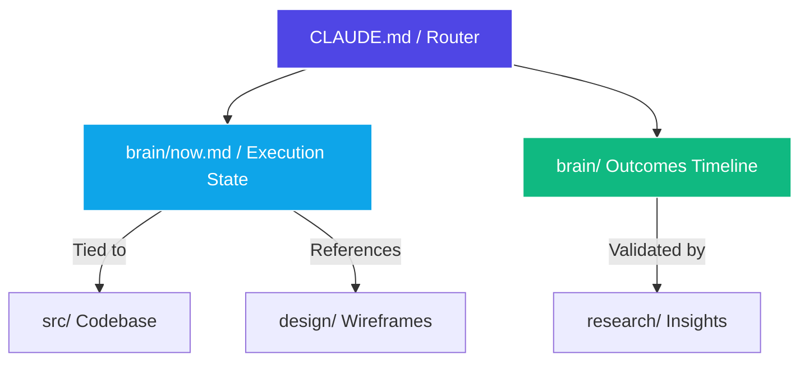

# UXAI Context Brain Setup Guide 🧠

This document provides complete instructions to port and initialize an asynchronous, graph-linked project brain within your work computer's `uxai-context` repository using **VS Code** and **Foam**. 

This system bridges the gap between **Dev** (code repositories & agents), **Design** (UI flows & canvases), and **Research** (user insight & AI behavioral patterns) using flat-identifier semantic markdown links `[[filename]]`.

---

## 🧭 System Architecture & Naming Conventions

To avoid context fragmentation, project memory is structured into a 3-layer timeline node hierarchy.



### 1. `CLAUDE.md` (The Router)
* **Purpose:** System entry point and instruction manual for both humans and AI agents (such as Claude Code or Cursor). Defines tech stack architectures, core rules, styling paradigms, and base navigation pointers.
* **Usage:** Checked first before starting major architectural shifts.

### 2. `brain/now.md` (The High-Velocity State)
* **Purpose:** Acts as the daily working memory and execution focus router. Contains active threads, immediate team blockers, and a log linking to chronologically stamped outcomes.
* **Usage:** Updated daily like an asynchronous standup log.

### 3. `brain/YYYY-MM-DD-[outcome-label].md` (The Chronological Timeline Nodes)
* **Purpose:** Long-term strategy timeline anchors. Instead of maintaining an infinitely growing ledger file, milestones, sprints, and Architecture Decision Records (ADRs) are split into standalone files using strict date stamps and explicit event tags.
* **Usage:** Linked directly inside `now.md` to map strategic progress over time on the visual node engine.

---

## 🐍 Workspace Automation Payload (`setup_uxai_workspace.py`)

Save the following Python source code into a file named `setup_uxai_workspace.py` at the root of your local workspace directory. Run it to scaffold the workspace, generate configurations, install plugins, and seed starting templates.

```python
import os
import subprocess
import sys

def run_cmd(cmd):
    try:
        subprocess.check_call(cmd, shell=True)
    except subprocess.CalledProcessError as e:
        print(f"Error executing command: {cmd}. Ensure VS Code 'code' CLI is available.")

print("🚀 Launching UXAI Context Brain Environment Builder...")

# 1. Environment Extension Provisioning via VS Code CLI
print("📦 Fetching Core Core Graphic and Visual Extensions...")
run_cmd("code --install-extension foam.foam-vscode")
run_cmd("code --install-extension tldraw-org.tldraw-vscode")
run_cmd("code --install-extension shd101wyy.markdown-preview-enhanced")

# 2. Directory Scaffolding
directories = [".vscode", "brain", "research", "design", "src"]
for folder in directories:
    if not os.path.exists(folder):
        os.makedirs(folder)
        print(f"Created: /{folder}")

# 3. Flat Identifier Optimization Settings
settings_json = """{
  "foam.edit.linkReferenceDefinitions": "withoutPath",
  "markdown.links.openLocation": "currentGroup",
  "foam.openDailyNote.directory": "brain",
  "search.useIgnoreFiles": true,
  "editor.wordWrap": "on",
  "editor.quickSuggestions": {
    "comments": "on",
    "strings": "on",
    "other": "on"
  }
}"""

with open(".vscode/settings.json", "w", encoding="utf-8") as f:
    f.write(settings_json.strip())

# 4. Core Blueprint Templates Generation
now_md = """# 📍 Execution State: Now

## ⚡ Active Threads
* **Focus 1:** Porting workspace models to target device -> Links: [[CLAUDE.md]], [[design/architecture.tldraw]]
* **Focus 2:** Stabilizing neural telemetry engine -> Links: [[src/agents/ux-optimizer.ts]]

## 🛑 Blockers & Friction
* Blocked on verification criteria mapped out inside [[2026-11-15-alpha-release]].

## 🪵 Historical Streams
* [[2026-11-09]]: Primed repository structure and anchored foam topology layers.
"""

with open("brain/now.md", "w", encoding="utf-8") as f:
    f.write(now_md.strip())

stamped_outcome_md = """---
date: 2026-11-15
status: pending
owner: @team
---
# 🎯 Target Outcome: Alpha Release Milestone

## 🏁 Verification Matrix
* Code base must inherit architectural guidelines dictated by [[CLAUDE.md]].
* Intent schemas must match empirical user telemetry documented within [[research/user-persona-beta.md]].

## 🛠️ Associated Implementation Hooks
* Core Agent File: [[src/agents/ux-optimizer.ts]]
* Visual UX Schematic: [[design/architecture.tldraw]]
"""

with open("brain/2026-11-15-alpha-release.md", "w", encoding="utf-8") as f:
    f.write(stamped_outcome_md.strip())

print("✅ Initialization Complete. Execute 'code .' and toggle 'Foam: Show Graph' via Ctrl/Cmd+Shift+P.")
```

---

## ⚡ Execution and Launch Runbook

Perform these deployment steps once you are on your work machine:

1. **Verify CLI Accessibility:** Open your terminal and confirm that running `code --version` outputs your editor version. If not, open VS Code, run `Ctrl+Shift+P` / `Cmd+Shift+P`, type `Shell Command: Install 'code' command in PATH`, and restart your terminal.
2. **Execute the Script:** Run the python configuration manager inside the root of your `uxai-context` repository:
   ```bash
   python setup_uxai_workspace.py
   ```
3. **Open and Initialize Engine:** Open the folder inside VS Code:
   ```bash
   code .
   ```
4. **Trigger Visualizers:**
   * Open the command palette (`Ctrl+Shift+P` / `Cmd+Shift+P`) and choose **`Foam: Show Graph`** to watch your nodes connect dynamically in real time.
   * Open any markdown node, right-click, and select **`Markdown Preview Enhanced: Open Preview Side by Side`** to render interactive Mermaid flowcharts or embedded UI wireframes smoothly.